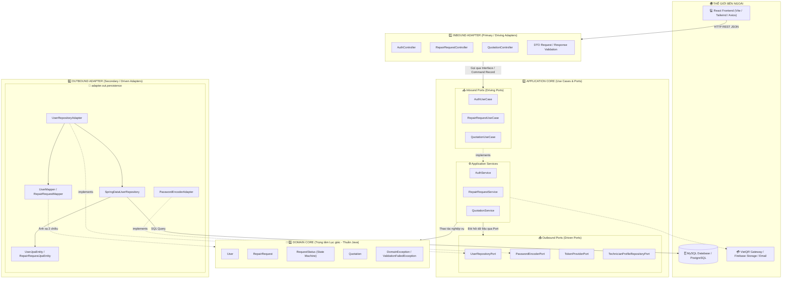
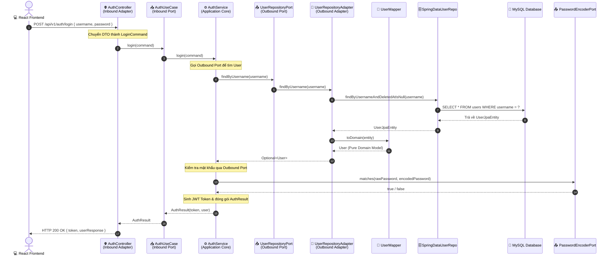
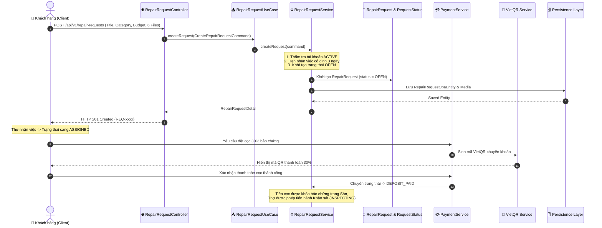

# BÁO CÁO THIẾT KẾ KIẾN TRÚC HEXAGONAL (PORTS & ADAPTERS)
## HỆ THỐNG NỀN TẢNG KẾT NỐI DỊCH VỤ SỬA CHỮA FIXLINK

---

## 1. TỔNG QUAN KIẾN TRÚC HEXAGONAL (PORTS & ADAPTERS)

Kiến trúc Hexagonal (hay còn gọi là **Kiến trúc Cổng và Bộ thích ứng - Ports & Adapters**) được khởi xướng bởi Alistair Cockburn (2005) với mục tiêu tối thượng:
> **"Tách biệt hoàn toàn logic nghiệp vụ cốt lõi (Domain Core & Application) khỏi các chi tiết công nghệ bên ngoài (Spring Framework, HTTP Controllers, Database, Third-party APIs)."**

### 1.1. Nguyên tắc Bất biến (Inward Dependency Rule)
- Mọi sự phụ thuộc **chỉ được phép hướng từ ngoài vào trong**.
- Lớp bên trong **không được phép biết hoặc import** bất kỳ class nào của lớp bên ngoài.
- Tầng **Domain Core** là trung tâm bất biến, hoàn toàn là Java thuần (POJO), không dính dáng đến JPA/Hibernate, Spring Boot annotations, hay HTTP Web.

---

## 2. SƠ ĐỒ KHỐI KIẾN TRÚC LỤC GIÁC TRONG FIXLINK

---

## 3. BẢN ĐỒ ÁNH XẠ CODE TRONG SOURCE CODE FIXLINK

Dưới đây là bảng đối chiếu chi tiết giữa **Khái niệm Hexagonal** và **Đường dẫn tệp mã nguồn cụ thể** trong thư mục `backend/src/main/java/com/fixlink`:

| Phân vùng Hexagonal | Vai trò & Trách nhiệm | Tệp mã nguồn cụ thể trong dự án |
| :--- | :--- | :--- |
| **💎 DOMAIN CORE** | Thực thể và quy tắc nghiệp vụ thuần túy. Không có Spring, không có JPA. | • `domain/model/User.java` • `domain/model/RepairRequest.java` • `domain/model/RequestStatus.java` *(State Machine)* • `domain/model/Quotation.java` • `domain/exception/DomainException.java` |
| **📥 INBOUND PORT** | Interface định nghĩa các Use Case mà bên ngoài có thể gọi vào hệ thống. | • `application/port/in/AuthUseCase.java` • `application/port/in/RepairRequestUseCase.java` • `application/port/in/QuotationUseCase.java` • `application/port/in/TechnicianProfileUseCase.java` |
| **⚙️ APPLICATION SERVICE** | Điều phối nghiệp vụ, thực thi Use Case, quản lý `@Transactional`. | • `application/service/AuthService.java` • `application/service/RepairRequestService.java` • `application/service/QuotationService.java` • `application/service/PaymentService.java` |
| **📤 OUTBOUND PORT** | Interface quy định dữ liệu và dịch vụ hạ tầng mà Application cần từ bên ngoài. | • `application/port/out/UserRepositoryPort.java` • `application/port/out/CustomerProfileRepositoryPort.java` • `application/port/out/TechnicianProfileRepositoryPort.java` • `application/port/out/PasswordEncoderPort.java` • `application/port/out/TokenProviderPort.java` |
| **🌐 INBOUND ADAPTER** | REST Controllers tiếp nhận HTTP request từ Client, gọi Inbound Port. | • `adapter/in/web/controller/AuthController.java` • `adapter/in/web/controller/RepairRequestController.java` • `adapter/in/web/controller/QuotationController.java` • `adapter/in/web/dto/*` *(Request / Response DTOs)* |
| **🔌 OUTBOUND ADAPTER** | Triển khai các Outbound Port, giao tiếp với CSDL qua Spring Data JPA. | • `adapter/out/persistence/adapter/UserRepositoryAdapter.java` • `adapter/out/persistence/adapter/PasswordEncoderAdapter.java` • `adapter/out/persistence/entity/*JpaEntity.java` • `adapter/out/persistence/mapper/*Mapper.java` • `adapter/out/persistence/repository/SpringData*Repository.java` |
| **🛡️ INFRASTRUCTURE** | Bộ lọc an ninh, cấu hình hệ thống, quản lý ngoại lệ toàn cục. | • `infrastructure/security/JwtAuthenticationFilter.java` • `infrastructure/config/SecurityConfig.java` • `infrastructure/exception/GlobalExceptionHandler.java` |

---

## 4. SƠ ĐỒ TUẦN TỰ (SEQUENCE DIAGRAM) LUỒNG THỰC THI END-TO-END

### Luồng 1: Xác thực người dùng (Login Flow)

---

### Luồng 2: Tạo đơn sửa chữa & Đặt cọc 30% (Repair Request & Escrow Deposit)

---

## 5. BA NGUYÊN TẮC VÀNG CHỐNG "ĐỨT LUỒNG" VÀ "NUỐT DỮ LIỆU" TRONG DỰ ÁN

1. **State Machine duy nhất (Single Source of Truth):**
   - Vòng đời trạng thái được bảo vệ tập trung tại `domain/model/RequestStatus.java`.
   - Mọi chuyển đổi trạng thái phải qua `RepairRequestService.updateStatus()`, chặn tuyệt đối tình trạng nhảy cóc trạng thái hoặc thao tác ngoài quyền hạn.
2. **Tính bất biến của dòng tiền (Financial Immutability):**
   - Tiền cọc 30% ban đầu sau khi thanh toán được hệ thống ghi nhận là bất biến.
   - Khi nghiệm thu tiền mặt, sàn khấu trừ 10% hoa hồng trực tiếp từ khoản cọc 30% đang giữ, và **cộng dồn 20% còn lại vào Ví FixLink của Thợ**, giúp thợ không bị khấu trừ âm và nhận trọn vẹn 90% giá trị hợp đồng.
3. **Ánh xạ 2 chiều chặt chẽ (Entity $\leftrightarrow$ Domain Model):**
   - Không để rò rỉ JPA Entity ra Controller và không nhận DTO trực tiếp vào Domain.
   - Mọi trường dữ liệu đều được ánh xạ qua các Mapper chuyên biệt (`UserMapper`, `RepairRequestMapper`), loại bỏ hoàn toàn hiện tượng "nuốt dữ liệu" (Data Swallowing).

---

## 6. KỊCH BẢN MẪU THUYẾT TRÌNH VỀ KIẾN TRÚC HEXAGONAL (DÀNH CHO BẢO VỆ ĐỒ ÁN)

> **Gợi ý thuyết trình 2 phút trước Hội đồng:**
> 
> *"Kính thưa Thầy/Cô trong Hội đồng, dự án FixLink được xây dựng hoàn toàn dựa trên **Kiến trúc Hexagonal (Ports & Adapters)**.*
>
> *Điểm mấu chốt của kiến trúc này trong hệ thống của nhóm em thể hiện ở 3 điểm:*
> 1. ***Lõi Domain hoàn toàn độc lập:** Trong package `com.fixlink.domain`, các model như `User`, `RepairRequest` và `RequestStatus` là các Java class thuần túy, không hề chứa bất kỳ annotation nào của JPA hay Spring. Điều này giúp toàn bộ quy tắc nghiệp vụ cốt lõi không bao giờ bị phụ thuộc vào công nghệ bên ngoài.*
> 2. ***Giao tiếp qua Cổng (Ports):** Tầng Application điều phối thông qua 2 loại cổng:
>    - **Inbound Ports (`port.in`):** Như `AuthUseCase`, `RepairRequestUseCase`, đóng vai trò là giao kèo để `adapter.in.web` (các REST Controllers) gọi vào. Controller của tụi em chỉ inject interface Port chứ không hề phụ thuộc trực tiếp vào Service implementation.
>    - **Outbound Ports (`port.out`):** Như `UserRepositoryPort`, `PasswordEncoderPort`, đảo ngược sự phụ thuộc (DIP). Tầng Service chỉ yêu cầu interface, còn việc lưu xuống MySQL qua JPA hay mã hóa mật khẩu bằng BCrypt sẽ do `adapter.out.persistence` đảm nhiệm.*
> 3. ***Khả năng mở rộng và Kiểm thử:** Nhờ cách ly bằng Ports, nhóm em đã viết được hơn **190 Unit Tests** chạy độc lập mà không cần khởi động CSDL hay Spring Context nặng nề. Sau này nếu hệ thống muốn thay đổi CSDL sang NoSQL hay đổi nhà cung cấp thanh toán, tầng nghiệp vụ lõi được bảo toàn 100% không cần chỉnh sửa."*
