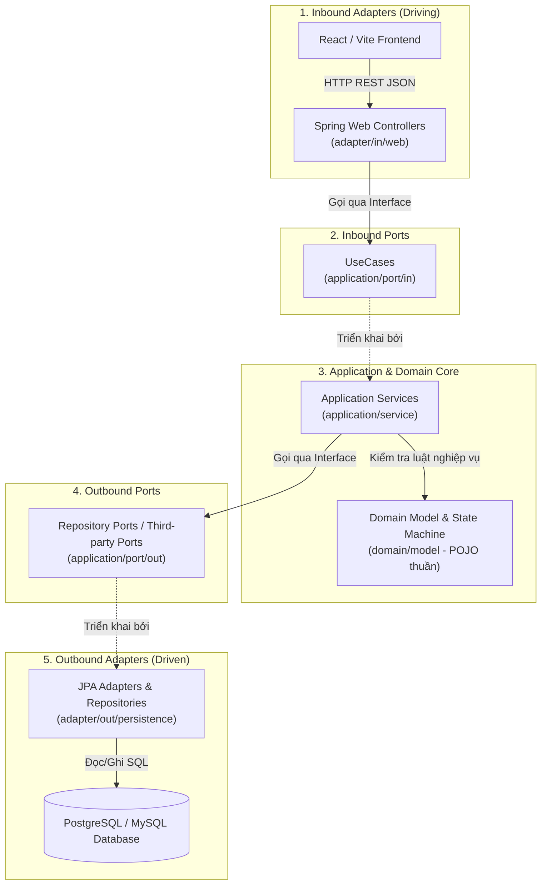
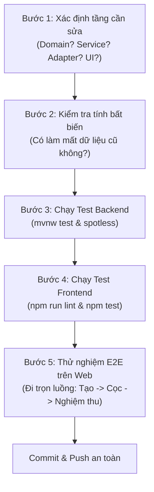

# FIXLINK HEXAGONAL ARCHITECTURE: BẢN HƯỚNG DẪN VÁ AN TOÀN (SAFE-PATCHING BLUEPRINT)

> [!IMPORTANT]
> **Mục tiêu tối thượng (4 ngày trước hạn chót):**
> Vừa giải quyết dứt điểm 30% công việc còn lại, vừa **bảo vệ 100% tính nguyên vẹn của Kiến trúc Hexagonal** để đạt điểm tối đa khi vấn đáp bảo vệ, triệt tiêu hoàn toàn nguy cơ **mất dữ liệu (Data Loss)** và **đứt luồng (Workflow Broken)**.

---

## 1. BẢN ĐỒ KIẾN TRÚC HEXAGONAL CHUẨN CỦA FIXLINK

Mô hình luồng chuẩn của một tính năng trong FixLink tuân theo nguyên lý **Phụ thuộc hướng vào tâm (Dependency Inversion)**:



---

## 2. 5 NGUYÊN TẮC VÀNG CHỐNG XUNG ĐỘT & ĐỨT LUỒNG

### Nguyên tắc 1: State Machine là Chân lý duy nhất (Single Source of Truth)
Mọi trạng thái của `RepairRequest` phải tuân thủ nghiêm ngặt vòng đời tại `domain/model/RequestStatus.java`:

```
DRAFT → OPEN → ASSIGNED → DEPOSIT_PAID → INSPECTING → (AWAITING_COST_APPROVAL) → IN_PROGRESS → AWAITING_ACCEPTANCE → COMPLETED
  ↓       ↓        ↓            ↓            ↓                    ↓                  ↓                  ↓             
CANCELLED ------------------------------------------------------------------------------------------------------------>
```

> [!CAUTION]
> **Tuyệt đối không đi tắt đón đầu (No Shortcut Transitions):**
> - **Sai lầm trước đây:** Cho phép `ASSIGNED` nhảy thẳng sang `INSPECTING` khi thợ bấm khảo sát $\rightarrow$ Dẫn đến đơn hàng chưa có tiền cọc trong DB, khiến bước nghiệm thu về sau nổ lỗi 500 do thiếu bản ghi cọc!
> - **Quy tắc chuẩn:** Nếu nghiệp vụ yêu cầu bước X phải xảy ra trước bước Y, cả **Backend Service** lẫn **Frontend UI** phải cùng khóa chặt cổng điều kiện.

---

### Nguyên tắc 2: Dữ liệu Cốt lõi là Bất biến (Immutability of Core Fields)
Khi phát sinh các tính năng mới (như phụ thu linh kiện, đổi thợ, dời lịch hẹn):
- **Không bao giờ ghi đè (Never Overwrite) các trường đã chốt:**
  - `depositAmount` (30% cọc ban đầu): Giữ nguyên vẹn sau khi đã chốt và thanh toán.
  - `customerId`, `requestCode`, `createdAt`: Không bao giờ thay đổi.
- **Áp dụng mô hình Cộng dồn / Bổ sung (Additive / Append-Only):**
  - Chi phí linh kiện phát sinh $\rightarrow$ Lưu vào bảng `additional_costs` hoặc cộng vào khoản tất toán cuối cùng (`FinalPayment = 70% + Surcharge`), không đụng vào `depositAmount`.
  - Thay đổi trạng thái $\rightarrow$ Luôn ghi vào bảng `work_progress` để lưu vết lịch sử kiểm toán (Audit Trail).

---

### Nguyên tắc 3: Cô lập Giao dịch (Transaction Isolation & Anti-Rollback)
Trong Spring Boot, khi phương thức A có `@Transactional` gọi phương thức B cũng có `@Transactional`:
- Nếu B ném `RuntimeException` (dù là `DomainException`), Spring sẽ đánh dấu giao dịch vật lý là **`rollback-only`**.
- Khi A kết thúc, Spring quăng lỗi `UnexpectedRollbackException` $\rightarrow$ Nổ **Lỗi 500 "Hệ thống đang gặp sự cố"**.

> [!TIP]
> **Giải pháp khi Service này gọi Service khác:**
> 1. Dùng `@Transactional(propagation = Propagation.REQUIRES_NEW)` cho các thao tác phụ trợ (như tạo mã QR, ghi log thông báo, tạo hóa đơn phụ).
> 2. Hoặc kiểm tra điều kiện an toàn (Safe Pre-check) bằng `Optional` thay vì ném exception bừa bãi làm vỡ luồng chính.

---

### Nguyên tắc 4: Đồng bộ Khế ước Dữ liệu (FE - BE Contract Synchronization)
Mỗi trường dữ liệu trao đổi giữa Backend DTO và Frontend TypeScript phải có một ý nghĩa duy nhất:

| Trường dữ liệu | Ý nghĩa đúng | Hiểu nhầm phổ biến cần tránh |
| :--- | :--- | :--- |
| `req.depositAmount` | **Số tiền cọc cần nộp** (30% giá chốt) | *Không phải* cờ "đã đóng cọc hay chưa". Muốn biết đã đóng hay chưa, kiểm tra `req.status === 'DEPOSIT_PAID'`. |
| `req.status` | Trạng thái vòng đời chính của đơn hàng | Không dùng cờ UI tự biên tự diễn để đoán trạng thái. |
| `appt.status` | Trạng thái của **cuộc hẹn khảo sát** | *Không đại diện* cho việc hoàn tất sửa chữa đơn hàng. |
| `payment.status` | Trạng thái giao dịch tài chính (`PENDING` / `CONFIRMED`) | Độc lập với tiến độ cơ học của máy móc. |

---

### Nguyên tắc 5: Rào chắn Giao diện (Frontend Render Gates)
Trên Frontend, mỗi Component/Nút bấm quan trọng phải có một **Rào chắn (Render Gate)** rõ ràng:

```typescript
// Ví dụ: Nút "Bắt đầu khảo sát hiện trường" của thợ
const canStartInspection = 
    req.status === 'DEPOSIT_PAID' &&      // 1. Khách BẮT BUỘC đã cọc 30%
    hasActiveAppointment &&              // 2. Đã có lịch hẹn trên hệ thống
    isAssignedToMe;                      // 3. Đúng thợ được giao

if (canStartInspection) {
    // Render nút bấm hành động
} else if (req.status === 'ASSIGNED') {
    // Render thông báo chờ khách cọc
}
```

---

## 3. CHECKLIST "VÁ NHANH KHÔNG RỤNG" CHO 30% CÔNG VIỆC CÒN LẠI

Trước khi commit bất kỳ thay đổi nào trong 4 ngày tới, hãy chạy checklist 5 bước sau:



### Chi tiết từng bước:
1. **Kiểm tra tính tương thích Hexagonal:**
   - DTO nằm ở `adapter/in/web/dto`.
   - Domain Model nằm ở `domain/model` (không import Spring, JPA hay Hibernate).
   - Service triển khai đúng `UseCase` interface từ `application/port/in`.
2. **Kiểm tra Spotless & Format Backend:**
   - Chạy: `.\mvnw.cmd spotless:apply -B` và `.\mvnw.cmd test -B`.
   - Đảm bảo 180/180 test case luôn xanh.
3. **Kiểm tra TypeScript & Vitest Frontend:**
   - Chạy: `npm run lint` (hoặc `npx tsc --noEmit`).
   - Chạy: `npm test`.
   - Đảm bảo 48/48 test case luôn xanh và 0 lỗi TypeScript compilation.
4. **Kiểm tra luồng người dùng (E2E Smoke Test):**
   - Đăng nhập Khách $\rightarrow$ Tạo đơn $\rightarrow$ Thợ báo giá $\rightarrow$ Khách chọn $\rightarrow$ Lên lịch hẹn $\rightarrow$ Khách duyệt lịch $\rightarrow$ Hiện QR cọc tự động $\rightarrow$ Cọc xong $\rightarrow$ Mở nút khảo sát $\rightarrow$ Báo phát sinh $\rightarrow$ Sửa xong $\rightarrow$ Nghiệm thu & QR tất toán $\rightarrow$ Hoàn tất.
